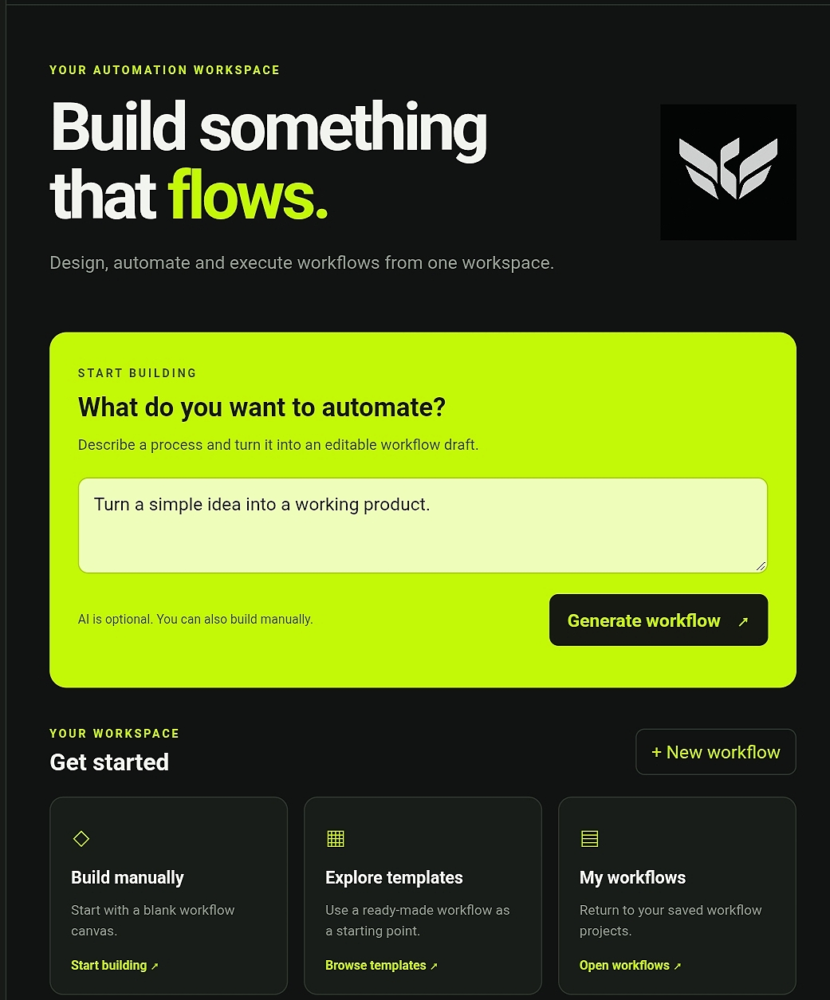

Welvox Flow Engine

Build. Connect. Automate.

Welvox Flow Engine is a visual workflow-building project designed to make automation easier to understand and create. It brings workflow creation into a clean, modern interface where users can organize steps and build automation flows visually.

  <strong>Version 0.1.0</strong>
   
  <em>Visual Workflow Builder · Mobile-Friendly Interface</em>

---

  

✨ Overview

Welvox Flow Engine aims to make workflow creation accessible through a visual, easy-to-use workspace.

Instead of working with complicated automation configurations, users can create workflows using visual blocks and connect different steps into a structured flow.

The project is being developed with a focus on simplicity, usability, and future extensibility.

🚀 Features

Visual Workflow Builder

- Create workflows using visual blocks.
- Add triggers, actions, conditions, and outputs.
- Select and organize workflow steps.
- Connect blocks to represent workflow structure.
- Edit workflow names and descriptions.

Workflow Management

- Create and manage workflows.
- Save workflows in the browser.
- Reopen and edit saved workflows.
- Organize automation ideas in one workspace.

User Interface

- Modern dark interface.
- Lime-accented Welvox visual identity.
- Responsive design for mobile and desktop screens.
- Dedicated dashboard and builder experience.

🧩 Workflow Blocks

Block| Purpose
Trigger| Represents what starts a workflow
Action| Represents a task performed in the workflow
Condition| Represents a decision or logical check
Output| Represents the result of a workflow

🛠️ Technology

The project uses web technologies:

- HTML
- CSS
- JavaScript
- Browser Local Storage
- GitHub Pages for frontend hosting

The project also has a separate backend service planned for API-based functionality.

🌐 Live Project

Website: Add your GitHub Pages URL here.

Live: https://piyush2707.github.io/welvox-flow-engine/

📱 Run Locally

1. Download or clone the repository.
2. Open "index.html" in a browser.
3. Start exploring the dashboard and workflow builder.

Some features may require the hosted backend or a supported browser environment.

📂 Project Structure

welvox-flow-engine/
│
├── index.html
├── styles.css
├── app.js
│
├── builder.html
├── builder.css
├── builder.js
│
└── assets/
    ├── welvox-symbol.png
    └── welvox-wordmark.png

💾 Data Storage

The current browser-based workflow workspace uses Local Storage to save workflow data.

This means saved workflows are stored in the browser on the device where they were created. They are not automatically synchronized across different devices or browsers.

🗺️ Roadmap

- [x] Initial dashboard interface
- [x] Visual workflow builder interface
- [x] Workflow block system
- [x] Browser-based workflow storage
- [ ] Reliable dashboard and builder integration
- [ ] Backend API integration
- [ ] Workflow execution engine
- [ ] More advanced conditions and connections
- [ ] User accounts and cloud synchronization
- [ ] Workflow sharing and collaboration

🤝 Contributing

Ideas, suggestions, and contributions are welcome.

If you find a bug or have an idea for improvement, open an issue in the repository.

📄 License

This project is intended to be released under the MIT License. Add a "LICENSE" file to the repository before treating the project as officially MIT-licensed.

---

  <strong>WELVOX FLOW ENGINE</strong>
   
  Build workflows. Connect ideas. Create automation.

